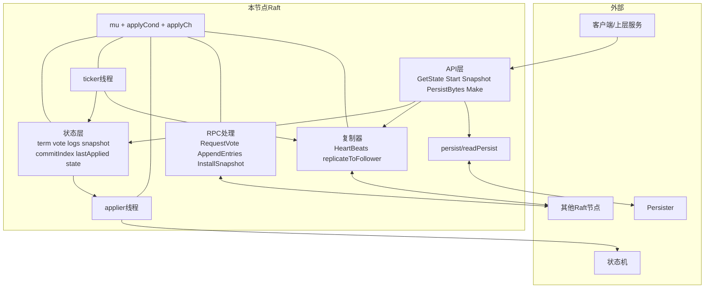
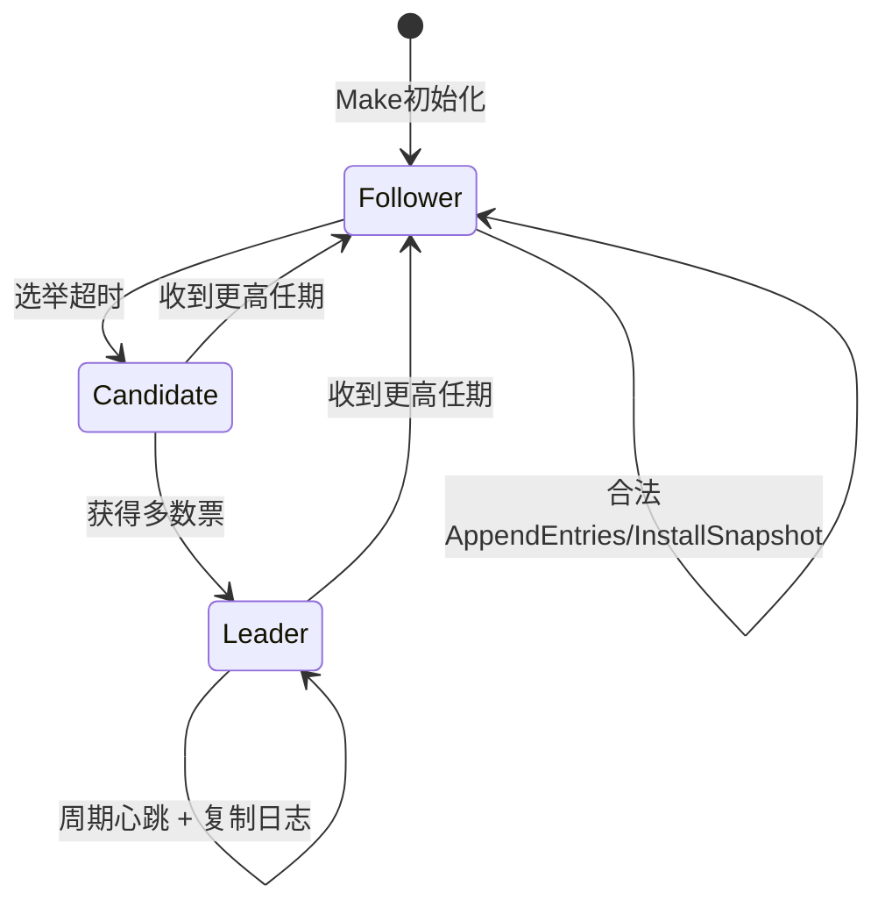
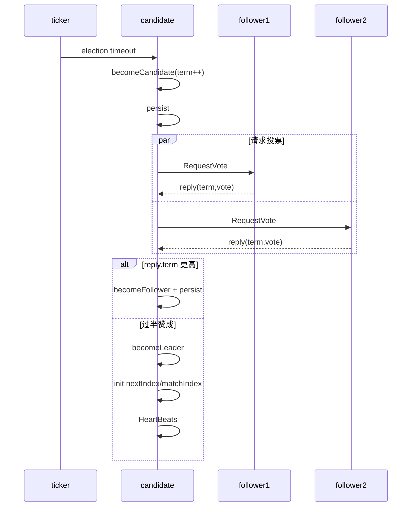
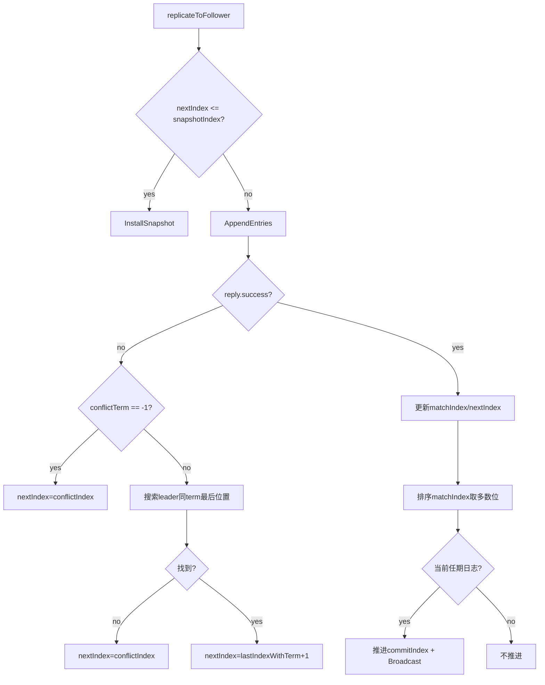
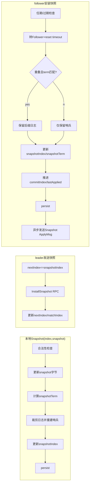
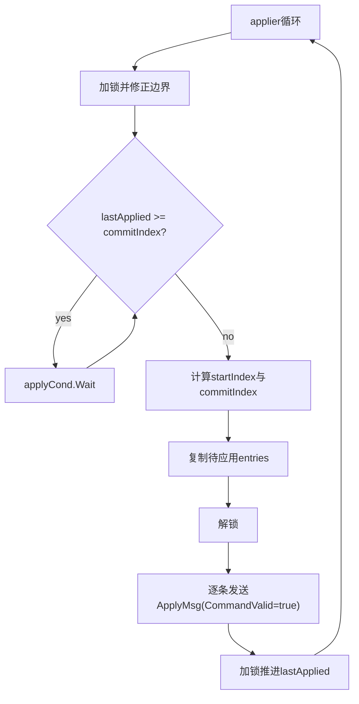

# Raft1 设计架构文档（基于当前代码实现）

本文档针对以下实现文件进行设计级归纳：
- raft.go
- raft_utils.go

目标：完整覆盖当前实现中的所有核心流程与关键分支，便于实验报告、答辩和后续维护。

---

## 1. 总体架构

当前实现将一个 Raft 节点组织为三层：

1. 对外接口层
- `GetState()`
- `Start(command)`
- `Snapshot(index, snapshot)`
- `PersistBytes()`
- `Make(...)`

2. 协议处理层
- 选举相关：`startElection()`、`RequestVote()`
- 日志复制相关：`HeartBeats()`、`replicateToFollower()`、`AppendEntries()`
- 快照相关：`snapshotToFollower()`、`InstallSnapshot()`

3. 后台执行层（并发）
- `ticker()`：选举超时与 leader 心跳周期
- `applier()`：提交日志向状态机应用

并发控制与通信：
- 互斥锁 `mu` 保护绝大多数状态
- 条件变量 `applyCond` 唤醒应用线程
- 通道 `applyCh` 将 `ApplyMsg` 送达上层服务

---

## 2. 状态与数据模型

### 2.1 角色状态机

- `StateFollower`
- `StateCandidate`
- `StateLeader`

转移入口：
- follower/candidate 超时 -> `startElection()` -> candidate
- candidate 获得多数票 -> `becomeLeader()`
- 任意角色收到更高任期 -> `becomeFollower(term)`
- 同任期 follower 收到合法心跳/快照，保持 follower 并重置超时

### 2.2 日志与快照索引模型

实现采用“逻辑索引 + 物理下标”解耦：
- 逻辑索引：Raft 全局日志编号
- 物理下标：当前 `logs` 切片下标

映射函数：
- `LogicalToPhysical(index) = index - snapshotIndex`
- `PhysicalToLogical(index) = index + snapshotIndex`

约束：
- `logs[0]` 始终作为哨兵条目（其 term 与快照边界对齐）
- `GetLastLogIndex()` 返回逻辑末尾编号
- `GetLastLogTerm()` 返回末尾任期

### 2.3 持久化状态

持久化字段：
- `currentTerm`
- `votedFor`
- `logs`
- `snapshotIndex`
- `snapshotTerm`
- `snapshot`（由 `persister.Save(raftstate, snapshot)` 第二参数保存）

恢复路径：
- `readPersist(persister.ReadRaftState())`
- `snapshot = persister.ReadSnapshot()`

恢复后矫正：
- 若日志为空，补哨兵
- `logs[0].Term = snapshotTerm`
- `commitIndex/lastApplied` 至少推进到 `snapshotIndex`

---

## 3. 并发模型

### 3.1 goroutine 组成

- `Make()` 启动：
  - `go ticker()`
  - `go applier()`

- `ticker()` 根据角色行为分岔：
  - follower/candidate：检查超时，触发 `startElection()`
  - leader：周期触发 `HeartBeats()`

- `HeartBeats()` 对每个 follower 并发启动：
  - `go replicateToFollower(server)`

- RPC handlers (`RequestVote/AppendEntries/InstallSnapshot`) 由 RPC 框架并发调用

### 3.2 锁策略与通道策略

- 大多数状态读写都在 `mu` 内
- 网络 RPC 调用时主动释放锁，避免长时间占锁
- `applier` 在通道发送前释放锁，避免死锁
- 快照安装后发送快照 ApplyMsg 使用异步 goroutine，避免持锁阻塞

---

## 4. 全流程设计

### 4.1 节点启动与恢复流程（Make）

1. 初始化基础字段（term、vote、角色、日志哨兵、索引数组）
2. 建立 `applyCond` 和 `applyCh`
3. 从持久化恢复 raft 状态和 snapshot
4. 启动 `ticker` 与 `applier`

关键点：
- 节点初始是 follower
- 初始日志含哨兵条目
- 恢复逻辑保证快照边界一致性

### 4.2 选举触发流程（ticker -> startElection）

1. follower/candidate 在 `ticker` 中检测：
   - `time.Since(lastHeartbeat) > electionTimeout`
2. 触发 `startElection()` 并重置选举超时
3. `startElection()` 内：
   - `becomeCandidate()`：`term++`，投票给自己
   - 记录当前 `term`、`lastLogIndex`、`lastLogTerm`
   - 先 `persist()` 再并发发起 RequestVote

### 4.3 拉票与收票流程（RequestVote 双端）

候选人端：
1. 并发发送 `RequestVote(term, candidateId, lastLogTerm, lastLogIndex)`
2. 收到回复后检查：
   - 当前是否仍是同一轮 candidate
   - 若 `reply.Term > currentTerm` -> 退回 follower 并持久化
   - 若赞成票过半 -> `becomeLeader()`

投票者端（`RequestVote`）：
1. 若请求任期更小，拒绝
2. 若请求任期更大，转 follower 并更新 term
3. 比较日志新旧：
   - 仅当候选人日志不落后才可能投票
4. 未投票或已投给该候选人才同意
5. 同意投票后：
   - 记录 `votedFor`
   - 重置选举超时
   - 保持/转 follower
   - 持久化

### 4.4 leader 建立与心跳流程

`becomeLeader()`：
1. 状态置为 leader
2. 初始化每个 follower：
   - `nextIndex[i] = logicalLen(logs)`
   - `matchIndex[i] = 0 的逻辑索引`
3. 立即发送一轮 `HeartBeats()`

`ticker` 里 leader 周期继续触发 `HeartBeats()`。

### 4.5 客户端命令进入流程（Start）

1. 若本节点不是 leader，直接返回失败标记
2. leader 将 `(term, command)` 追加到本地日志
3. 计算新条目逻辑索引
4. 先持久化，再触发 `HeartBeats()` 加速复制
5. 立即返回给上层（异步达成共识）

### 4.6 follower 复制分流流程（replicateToFollower）

1. 校验自己仍是 leader
2. 分支判断：
   - 若 `nextIndex[peer] <= snapshotIndex` -> 走快照发送
   - 否则 -> 走 AppendEntries 日志发送

### 4.7 AppendEntries 接收与冲突处理流程

接收端（follower `AppendEntries`）：
1. 任期检查：
   - 低任期拒绝
   - 高任期更新为 follower
2. 合法 leader 请求会重置超时并置 follower
3. 一致性检查：
   - `PrevLogIndex` 超出本地末尾 -> 拒绝，回传 `ConflictIndex = localEnd`
   - `PrevLogIndex < snapshotIndex` -> 拒绝，回传 `snapshotIndex + 1`
   - `PrevLogTerm` 不匹配 -> 拒绝，回传冲突任期和该任期最早索引
4. 检查通过后进行日志对齐：
   - 前缀任期相同跳过
   - 首次冲突点截断并追加 leader 新后缀
5. 若 `LeaderCommit > commitIndex`：
   - `commitIndex = min(LeaderCommit, lastNewEntry)`
   - `applyCond.Broadcast()`
6. 状态改变时持久化

发送端（leader `entriesToFollower`）：
1. 构造 AppendEntries 参数（`prevLog* + entries + leaderCommit`）
2. 发 RPC，回包后再次校验身份/任期
3. 失败分支：
   - `ConflictTerm == -1`：直接跳到 `ConflictIndex`
   - 否则在 leader 本地搜索该任期最后位置，决定 `nextIndex`
4. 成功分支：
   - 更新 `matchIndex/nextIndex`
   - 复制并排序 `matchIndex`，取多数位作为候选提交点
   - 仅当该点日志属于当前任期才推进 `commitIndex`
   - 推进后 `applyCond.Broadcast()`

### 4.8 日志应用流程（applier）

1. 循环运行直到被 kill
2. 防御性修正：
   - `lastApplied >= snapshotIndex`
   - `commitIndex >= snapshotIndex`
3. 当 `lastApplied >= commitIndex` 时在 `applyCond` 上等待
4. 醒来后计算本次批量应用区间 `[startIndex, commitIndex]`
5. 拷贝日志切片（锁内）
6. 解锁后逐条发送 `ApplyMsg{CommandValid=true}` 到 `applyCh`
7. 重新加锁，将 `lastApplied` 推进到至少 `commitIndex`

### 4.9 本地快照生成流程（Snapshot）

1. 参数合法性检查：
   - `index` 不能小于当前 `snapshotIndex`
   - `index` 不能大于 `lastApplied`
2. 写入新 snapshot 字节
3. 设置 `snapshotTerm = log[index].Term`
4. 裁剪日志：
   - 保留 `index` 之后的条目
   - 新 `logs[0]` 为哨兵（`term=snapshotTerm`）
5. 更新 `snapshotIndex = index`
6. 持久化

### 4.10 快照发送流程（leader -> follower）

触发条件：`nextIndex[peer] <= snapshotIndex`

1. 构造 `InstallSnapshotRequest`（当前实现按整块发送）
2. 发 RPC，回包后再做身份/任期校验
3. 若对端任期更高，降级 follower 并持久化
4. 成功时推进：
   - `nextIndex = lastIncludedIndex + 1`
   - `matchIndex = max(matchIndex, lastIncludedIndex)`

### 4.11 快照安装流程（InstallSnapshot）

follower 处理：
1. 任期检查：低任期直接返回
2. 过期快照检查：`LastIncludedIndex <= snapshotIndex` 返回
3. 合法后转/保持 follower，重置选举超时
4. 安装快照数据
5. 与本地日志重叠判断：
   - 若 `LastIncludedIndex` 在本地范围且同 term，保留后缀日志
   - 否则丢弃本地日志，仅保留哨兵
6. 更新 `snapshotIndex/snapshotTerm`
7. 推进 `commitIndex/lastApplied` 至快照边界
8. 持久化
9. 异步发送 `ApplyMsg{SnapshotValid=true}` 到上层

### 4.12 崩溃恢复一致性流程

1. 节点重启进入 `Make`
2. `readPersist` 恢复 term/vote/logs/snapshot 元信息
3. `ReadSnapshot` 恢复快照字节
4. 恢复后矫正日志哨兵与提交/应用指针
5. 后台线程继续驱动协议前进

---

## 5. Mermaid 架构图（全流程）

### 5.1 总体结构图

### 5.2 角色状态机图

### 5.3 选举流程时序图

### 5.4 日志复制与提交图

### 5.5 快照全流程图

### 5.6 应用线程流程图

---

## 6. 关键设计决策与效果

1. 逻辑索引与物理数组分离
- 优点：快照裁剪后仍能保持全局索引语义稳定。

2. 哨兵日志项
- 优点：降低边界复杂度，便于 prevLogTerm 与 snapshot 边界对齐。

3. 复制失败快速回退
- 用 `ConflictTerm + ConflictIndex` 避免逐项回退，提高追赶效率。

4. 提交保护
- 仅提交当前任期日志，减少旧任期日志导致的安全性风险。

5. 应用线程批量化
- 先复制区间后解锁发送，降低锁竞争与死锁概率。

6. 快照安装的保后缀策略
- 若边界 index+term 匹配则保留后缀，减少重传。

---

## 7. 当前实现的边界与注意事项

1. `InstallSnapshotRequest` 包含 `Offset` 和 `Done` 字段，但当前按整块快照发送，未实现分块传输。
2. `ticker` 与 `Start` 都可触发心跳复制，属于“周期+事件”双触发模式。
3. 状态变化后普遍伴随持久化，保证崩溃恢复一致性。

---

## 8. 快速索引（函数到流程）

- 启动恢复：`Make`、`readPersist`、`persist`
- 选举触发：`ticker`、`resetElectionTimeout`
- 候选拉票：`startElection`、`sendRequestVote`
- 投票处理：`RequestVote`
- leader 建立：`becomeLeader`
- 命令入口：`Start`
- 复制分流：`replicateToFollower`
- 日志复制：`makeAppendEntriesArgs`、`sendAppendEntries`、`AppendEntries`、`entriesToFollower`
- 快照发送：`snapshotToFollower`、`sendInstallSnapshot`
- 快照安装：`InstallSnapshot`
- 状态机应用：`applier`

---

## 9. 一句话总结

该实现形成了“事件驱动（Start/超时）+ 周期驱动（ticker）+ 条件驱动（applyCond）”的混合推进架构，在日志复制与快照机制上做了完整实现，并通过持久化与索引映射保证了崩溃恢复和快照裁剪下的一致性语义。
