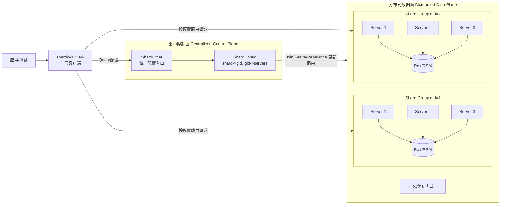
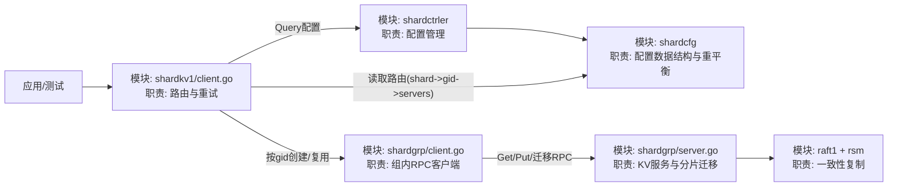
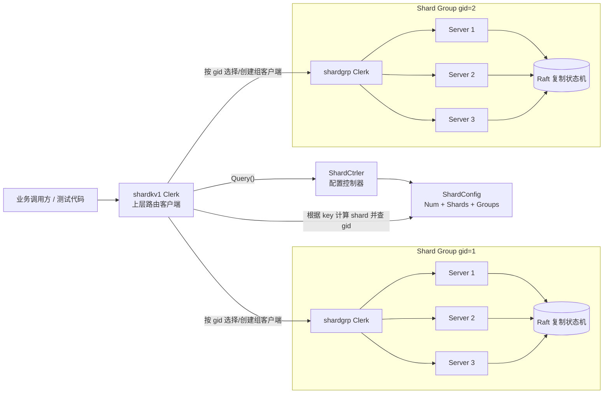
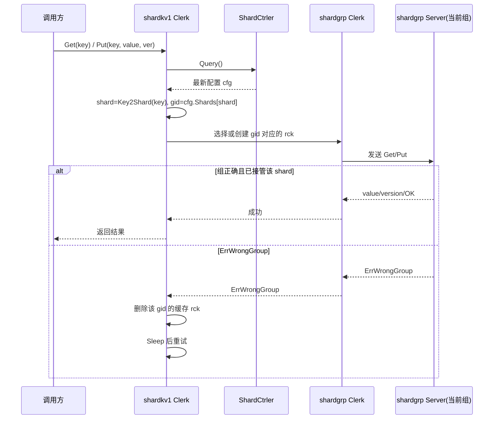

# ShardKV1 系统架构可视化

本文档展示当前实验代码中的分层架构、核心数据流和一次 `Get/Put` 请求的执行路径。

## 0. 集中与分布式主图（推荐先看）



一句话理解：

- 集中的是“配置决策”（由 ShardCtrler 统一给出路由）。
- 分布式的是“数据存储与复制”（由多个 shard group 并行承载）。

## 1. 模块图（方框与箭头）



补充说明：

- `shardkv1` 是上层入口模块，负责“找对组再发请求”。
- `shardctrler + shardcfg` 是控制平面，维护配置与重平衡。
- `shardgrp + raft/rsm` 是数据平面，负责实际数据读写与复制。

## 2. 组件总览



## 3. 路由与数据分层

```mermaid
graph TD
    K[key]
    SH[Key2Shard(key)]
    SHID[shard id]
    MAP1[ShardConfig.Shards\nshard -> gid]
    GID[gid]
    MAP2[ShardConfig.Groups\ngid -> servers[]]
    SRVS[servers[]]
    RCK[shardgrp Clerk]
    KV[目标 shardgrp Raft 组]

    K --> SH --> SHID --> MAP1 --> GID --> MAP2 --> SRVS --> RCK --> KV
```

说明：

- 上层 `shardkv1/client.go` 负责路由（找对组）。
- 下层 `shardgrp/client.go` + `shardgrp/server.go` 负责实际读写与复制。
- `shardctrler` 负责配置变更（Join/Leave/Rebalance）并对外提供 Query。

## 4. Get/Put 时序（含重配置）



## 5. 关键设计点

- 控制平面与数据平面分离：
  - 控制平面：`shardctrler` + `ShardConfig`。
  - 数据平面：各个 `shardgrp` 的 Raft 组。
- 客户端分层：
  - `shardkv1 Clerk` 管“路由”。
  - `shardgrp Clerk` 管“对组内 server 发 RPC”。
- 对动态重配置的兼容：
  - 通过 `ErrWrongGroup` 触发“丢弃旧路由并重试”。
